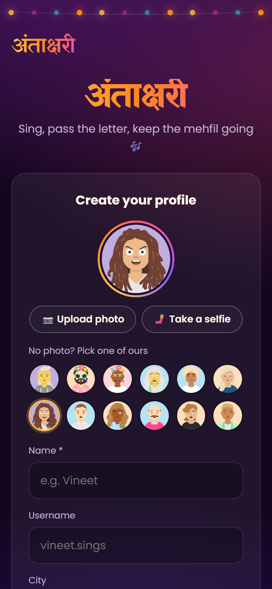
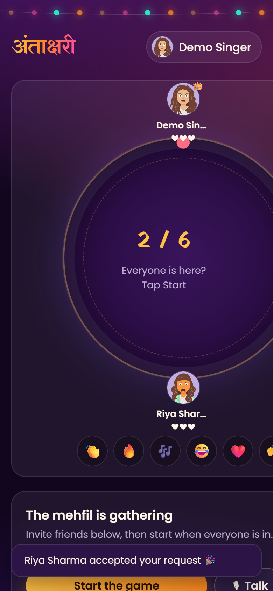

# Antakshari Mehfil

**The everyday problem:** antakshari is the song game every Indian family and friend group plays, but only when everyone is in the same room. Friends in different cities, or someone home alone, can't join in.

**The idea:** an online antakshari room. Make a profile, invite singers, and take turns singing a song that starts with the last letter of the previous one. You hear each other live, and there are bot singers so you can practise alone.

<p>
  
  
  
</p>

## What it does

- **Profiles:** name, username, city, bio, an uploaded photo or selfie (or a ready-made avatar), and up to 9 posts
- **Lobby:** see who's online, search singers, and send or accept invites to sing
- **Rooms of up to 6 players:** each turn has a 60-second timer and a starting letter; pass and you lose one of your 3 lives; the last singer standing wins
- **Live voice:** players hear each other through WebRTC; the server only connects them
- **Reactions:** 👏 🔥 🎶 😂 ❤️ 🙌 while someone sings
- **Bot singers:** made-up profiles that join, sing real Hindi film song titles and play by the rules, so you can try it alone

## Tech

- **Node.js** with **Express** for the pages and **Socket.IO** for real-time rooms, turns and invites
- **WebRTC** for voice between players (Socket.IO carries the signalling)
- Plain HTML, CSS and JavaScript on the front end, designed for phones first
- HTTPS with a self-signed certificate made on start-up, so phones on the same Wi-Fi can use the microphone
- Nothing is saved to disk: profiles and rooms live in memory

## Run it

```bash
cd mehfil-antakshari
npm install
npm start
```

- This computer: http://localhost:5090
- Phones and laptops on the same Wi-Fi: open the `https://<your-ip>:5443` address the server prints, and accept the certificate warning
- Tests: `npm test` plays a full game against the bots

> This is a local prototype of an idea, not a published app. The bot singers and their profiles are made up.

Built with Claude Code.
