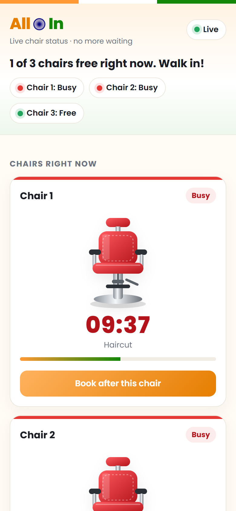
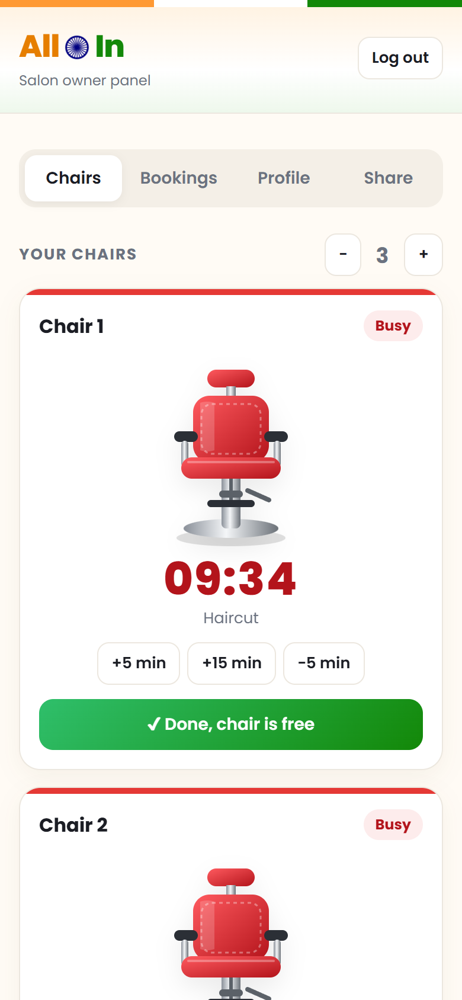
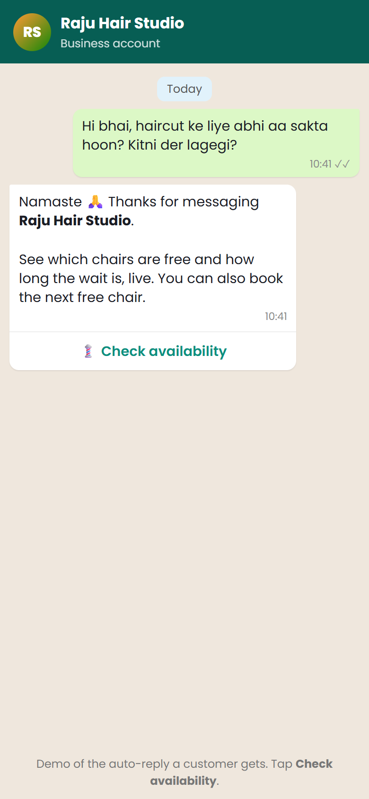

# Salon Chair Queue

**The everyday problem:** you walk to the salon, and every chair is busy. You don't know whether to wait 5 minutes or 50, so you either sit there or come back later and find it full again.

**The idea:** the salon shares one link (or a WhatsApp auto-reply). Customers see, live, which chairs are free and how long each busy chair has left, then book the next free chair from their phone. The owner runs it all from a simple panel.

<p>
  
  
  
</p>

## What it does

**For customers** (`/`)
- See every chair as Free or Busy, with a live countdown and the service in progress
- Book after a busy chair, and see your place in the queue
- If your turn comes, you get 5 minutes to arrive before the chair goes to the next person

**For the salon owner** (`/owner`, demo PIN `1234`)
- Start a chair with a service; the timer runs on its own
- Add or remove time (+5, +15, -5 min) and mark a chair free when done
- Accept, decline or check in bookings
- Add or remove chairs, edit the salon profile, services and prices
- Share the customer link

**WhatsApp demo** (`/whatsapp`): shows the auto-reply a customer would get, with a "Check availability" button.

## Tech

- Node.js with **no dependencies**: the built-in `http` module serves the pages and a small JSON API
- Plain HTML, CSS and JavaScript on the front end, designed for phones first
- Data is saved to a local `data.json` file (created on first run with a made-up demo salon)

## Run it

```bash
cd salon-chair-queue
node server.js
```

Then open http://localhost:5050 (customer), http://localhost:5050/owner (owner, PIN `1234`) and http://localhost:5050/whatsapp.
Phones on the same Wi-Fi can open the address the server prints.

> This is a local prototype of an idea, not a published app. The demo PIN and the salon in the screenshots are made up.

Built with Claude Code.
